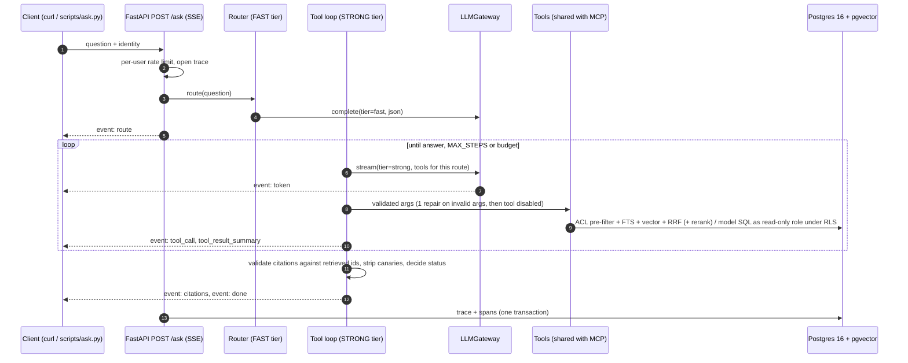

# portfolio-copilot

The backend "brains" of an assistant that answers multi-step questions across a portfolio of construction
projects: **permission-filtered hybrid retrieval**, an **explicit tool-calling loop** with **streamed, validated
citations**, **governed text-to-SQL under Row-Level Security**, a **model gateway** with per-request token and cost
budgets, an **MCP server**, **per-question tracing**, and a **deterministic eval that gates CI**.

> All data is **synthetic** (seeded generator, nothing real). No number in this repository is a claim about
> production usage: every figure comes from a script in this repo and its output file is committed.

## What it does

```
POST /ask  {"question": "Which approved change order on P1 is the largest, and why was it needed?"}
X-User-Email: carol@example.test

event: route                {"route": "both", "tools_enabled": ["search_documents", "open_document_section", "query_project_data"]}
event: tool_call            {"tool": "query_project_data", "args": {"question": "largest approved change order on P1", ...}}
event: tool_result_summary  {"sql": "SELECT change_order_id, amount FROM semantic.change_orders WHERE ... LIMIT 1", "row_count": 1}
event: tool_call            {"tool": "open_document_section", "args": {"doc_id": "P1-CO-005", "section": "Justification"}}
event: tool_result_summary  {"hits": [{"chunk_id": "P1-CO-005#1", ...}]}
event: token                {"turn": 2, "text": "P1-CO-005 ..."}            # real token streaming
event: citations            {"answer": "... [sql#1] ... [P1-CO-005#1]", "citations": [...], "removed": 0}
event: done                 {"status": "answered", "usage": {"total_tokens": ..., "cost_usd": ...}, "searched": [...]}
```

The same question from a user without access returns `status: not_found` — the documents and rows they cannot
see never leave the database.

## Architecture



| Layer | Where | Notes |
|---|---|---|
| Retrieval | `app/retrieval/hybrid.py` | One SQL statement: ACL pre-filter inside both CTEs → `tsvector` FTS + pgvector HNSW → RRF fusion → optional cross-encoder rerank |
| Permissions | `db/migrations/0001_schema.sql`, `0002_roles_rls.sql` | `visible_doc_ids()` / `visible_project_ids()` defined once; used by retrieval *and* by RLS policies |
| Text-to-SQL | `app/tools/query_project_data.py`, `sql_guard.py` | Governed `semantic.*` views; prompt rendered from `COMMENT ON`; sqlglot guard; executed as `copilot_readonly` in a read-only transaction with `statement_timeout` and RLS |
| Orchestration | `app/orchestration/loop.py` | ~380 lines, no framework; every failure path is a branch with a test |
| Gateway | `app/gateway/` | Tiers (fast/strong) → budget pre-check → Postgres cache → concurrency limit → retry (backoff + jitter, Retry-After) → provider; cost at list price |
| Providers | `app/gateway/providers/` | Groq and OpenAI via one OpenAI-compatible adapter; Bedrock interface stub with the mapping documented; fake providers for CI |
| MCP | `app/mcp_server.py` | Same tools, same schemas (`inputSchema == Tool.spec().parameters`), same permission path |
| Tracing | `app/tracing/`, `scripts/report.py` | Spans buffered in memory, one insert per question; p50/p95 via `percentile_cont` |
| Eval | `eval/` | 28 golden questions, deterministic metrics, gates: `permission_leaks == 0`, `canary_leaks_delivered == 0` |

## Key decisions and trade-offs

| Decision | Why | Rejected |
|---|---|---|
| Postgres + pgvector is the only datastore | ACL is a SQL join next to the HNSW/GIN scans; one backup, one failure domain | Separate vector DB (two sources of truth for ACL; payload filters are not joins) |
| ACL **pre-filter** in SQL | top-k never starved, invisible chunks never reach Python, logs or the model | Post-filtering in Python |
| Model SQL contained by the **database** (role + RLS + timeout + read-only tx), sqlglot guard as defence in depth | one parser bug must not equal a data leak | Validator-only guard |
| RRF + cross-encoder rerank | no score calibration between BM25-like and cosine scores | Weighted linear fusion |
| **No agent framework** here | a linear tool loop is a few hundred lines and fully testable with a fake provider; budgets are enforced in one place | LangGraph. I would use it for persistence/resume, human-in-the-loop, parallel branches or multi-agent graphs |
| Separate cheap router call | restricts the tool surface per question, refuses off-topic questions before any retrieval, gives a measurable route accuracy | Strong model with every tool decides |
| Citations validated post-hoc | deterministic quality signal without an LLM judge | Trusting the model / judge-only |
| Scripted fake provider in CI | tests plumbing and permissions deterministically; cassettes rot on every prompt change | VCR-style recordings |

## Quickstart

```bash
cp .env.example .env              # put GROQ_API_KEY=... in .env for live answers (offline eval needs none)
docker compose up -d --build
make seed                         # synthetic corpus → bge-small embeddings on CPU → Postgres
make ask Q="Which approved change order on P1 is the largest, and why was it needed?" USER_EMAIL=carol@example.test
make ask Q="What response was given to RFI P1-RFI-003?" USER_EMAIL=eve@example.test   # → not_found
make eval-offline                 # CI gate, no API key
make eval                         # live run against Groq → eval/results/latest-live.md
make report                       # p50/p95 latency, tokens and cost per question from traces
make test lint typecheck
```

Without `make`: `docker compose exec api uv run python scripts/seed.py`, `... python eval/run_eval.py --mode live`, etc.

Users (synthetic): `carol` exec (everything) · `alice` PM of P1+P2 (no contract clauses) · `bob` PM P1 + legal ·
`dave` contractor on P3 (daily reports and RFIs only) · `eve` no access.

## Results

Numbers are produced by `eval/run_eval.py` and committed under `eval/results/`; nothing is typed by hand.

- **Offline (scripted fake LLM)** — [`eval/results/latest-offline.md`](eval/results/latest-offline.md). Tests
  plumbing, permissions, citation validation and metric code; it says nothing about model quality.
- **Live (Groq)** — `eval/results/latest-live.md` after `make eval`. Models and the date are recorded in the file.

## Security notes

- Prompt injection: retrieved text is delimited as data (`<document>`, `<rows>`), the system prompt states the
  instruction hierarchy, three poisoned documents carry eval-only canaries, and the final answer is canary-checked.
  The model's SQL path cannot write: even an injected `DELETE` fails at the role, not just at the parser.
- Identity is a dev header behind one FastAPI dependency (`app/auth.py`); OIDC replaces that one function.

## Scaling to 1M+ documents / 10+ TB per client (design notes, not built)

- **Ingestion** as an async pipeline (queue → parse/OCR → chunk → embed in batches → upsert), idempotent per document
  version, with an ingestion-run table for the admin view.
- **Isolation per client**: a database (or cluster) per client in the client's own cloud account; within a client,
  partition `chunks` by project and keep the ACL join on indexed `principal_id`.
- **Index strategy**: HNSW with `iterative_scan` for filtered queries (pgvector ≥ 0.8), or IVFFlat/partitioned
  HNSW past ~50M chunks; FTS on GIN; consider a dedicated search engine only when one Postgres can no longer serve
  p95 targets — the ACL contract stays the same.
- **Cost**: prompt caching for the stable system prompt and tool specs, batch inference for summaries and
  re-embedding, model routing by question type (already the router tier).
- **Observability**: export the existing spans to OpenTelemetry/Langfuse; keep the deterministic eval as the CI gate
  and add a sampled LLM-judge only as a secondary signal.

## Limitations

- Synthetic corpus (111 documents); retrieval and latency at scale are not measured here.
- `infra/` (Terraform) is not part of this version; CI runs the Terraform job only when it exists.
- Rate limiting and the response cache are single-process (Redis / API Gateway in production).
- Bedrock is an interface stub; Groq and OpenAI are implemented.

See `docs/PHASE1_PLAN.md` for the full design and `docs/DEVIATIONS.md` for every departure from it.
