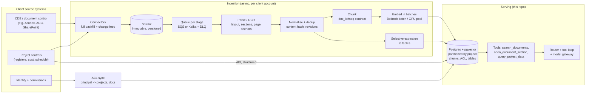

# Scaling portfolio-copilot to terabytes per client

**Status: design, not built.** This repository runs on a synthetic corpus of 111 documents. This document
describes how the same contracts (ACL before ranking, `doc_id#seq` citations, governed SQL, eval gates) carry over
to a real client with terabytes of project documents, what breaks first and how to measure it before
building. Every number below is an **estimate from stated assumptions** or a **list price with a source**, not a
measurement. The first step of the plan (section 9) is to replace the estimates with measurements.

---

## 1. Summary

- **Terabytes of files are not terabytes of text.** Most bytes in a construction common data environment are
  drawings, scans, photos, video and models. Per 1 TB of raw files I expect roughly 3–8 million chunks
  (section 2). A 10 TB client is tens of millions of chunks: large, but within reach of a partitioned Postgres +
  pgvector or a search engine.
- **The hard part is ingestion, not search.** Parsing and OCR, revisions and duplicates, incremental updates,
  permission sync and failure handling decide cost, freshness and answer quality.
- **Embeddings are cheap; OCR and LLM extraction are not.** Embedding a whole terabyte costs tens of dollars at
  list price, so the embedding model choice is reversible. OCR and LLM-based extraction must be selective.
- **Users almost never need the whole corpus.** Queries are scoped by client, project and permissions, so the
  index that answers a query is small. Partitioning by project is the main scaling lever.
- **Numbers belong in SQL, not in RAG.** Registers (change orders, RFIs, budgets) come from the source systems'
  APIs into tables; RAG is for the "why" and "what does the document say".

---

## 2. Capacity model (estimates)

Assumptions per **1 TB of raw files** (to be replaced by a profile of the real client data, section 9):

| Assumption | Value | Why |
|---|---|---|
| Share of bytes with no useful text (photos, video, BIM, CAD binaries) | ~40 % | indexed by metadata only |
| Average size of a document page (PDF / office) | ~200 KB | mix of vector drawings, scans, text PDFs |
| Pages per TB | 600 GB / 200 KB ≈ **3 M pages** | |
| Scanned pages that need OCR | ~30 % ≈ **1 M pages** | the rest has a text layer |
| Tokens per page | 300–1,000 (drawings low, specs high) | |
| Tokens per TB | **1–3 B tokens** | |
| Chunk size | ~400 tokens, section-aware | the current chunk contract |
| Chunks per TB | **3–8 M chunks** | |

What that means for one client with **10 TB**:

| Quantity | Estimate |
|---|---|
| Chunks | 30–80 M |
| Vectors, 1024-dim `halfvec` (2 KB each) | 60–160 GB, plus HNSW graph overhead |
| Vectors, 512-dim `halfvec` (1 KB each) | 30–80 GB |
| Raw extracted text | 10–30 B tokens ≈ 40–120 GB |
| Full-text index (GIN) | a fraction of the text size, tens of GB |

`halfvec` stores 16-bit floats and halves vector and index size
([Supabase on pgvector 0.7](https://supabase.com/blog/pgvector-0-7-0)). Titan Text Embeddings V2 can return
256, 512 or 1024 dimensions
([AWS announcement](https://aws.amazon.com/blogs/machine-learning/get-started-with-amazon-titan-text-embeddings-v2-a-new-state-of-the-art-embeddings-model-on-amazon-bedrock/)),
so dimension is a measured trade-off, not a fixed choice.

### One-off ingestion cost per TB (list prices, no volume discounts)

| Step | Volume | Price | Cost |
|---|---|---|---|
| OCR of scanned pages, Textract `DetectDocumentText` | 1 M pages | $0.0015 / page ([AWS](https://aws.amazon.com/textract/pricing/)) | ~$1,500 |
| Table extraction, Textract `AnalyzeDocument` Tables, only for schedules and registers | e.g. 50 k pages | $0.015 / page | ~$750 |
| Embeddings, Titan Text Embeddings V2 on Bedrock | 1–3 B tokens | $0.02 / 1 M tokens ([AWS](https://aws.amazon.com/blogs/machine-learning/get-started-with-amazon-titan-text-embeddings-v2-a-new-state-of-the-art-embeddings-model-on-amazon-bedrock/)) | $20–60 |
| LLM extraction over every page | 1–3 B input tokens | depends on model | the line to avoid |

Conclusions: re-embedding a client with a better model costs less than a day of engineering, so it is a normal
operation, not a migration. OCR is the main per-TB cost and has to be skipped where a text layer exists. LLM
extraction runs only on document types that feed a table and have no system of record (section 6).

---

## 3. Target architecture

The serving side is what this repository already has. Everything left of it is new, and it writes into the
same tables and the same chunk contract, so the agent, the tools and the eval do not change.

---

## 4. Ingestion pipeline

**Stages, each one idempotent.** `fetch → parse/OCR → normalise + dedup → chunk → embed → upsert`, plus a
parallel `extract` stage for registers. Every stage reads a message, writes its output keyed by
`(source_id, revision, content_hash)` and acknowledges. Re-running a stage on the same input writes nothing new.
A failed message goes to a dead-letter queue after N retries with the error stored, and can be replayed after a
fix. An `ingestion_runs` table holds per-document status for an admin view.

**Backfill vs incremental.** The first load of a client is a backfill: millions of files, throughput-bound,
run with many workers and Bedrock batch inference. After that the change feed (webhooks, polling by modified
date, S3 events) should move a small share of the corpus per day (to be measured in phase 0), and only changed
documents go through the pipeline. Freshness target to agree with the business, e.g. "a new RFI response is searchable within 15
minutes".

**Bottlenecks I expect, in order.** Source-system API rate limits (the connector, not our code, sets the backfill
speed), OCR quotas and cost, then parsing CPU. Embedding and database writes are not the bottleneck at these
volumes if loading uses `COPY` and builds indexes after bulk loads.

**Parsing.** Digital PDFs and office files are parsed locally (no per-page fee). Only pages without a text
layer go to OCR. Sections and page anchors are kept, because citations and `open_document_section` depend on
them. Drawings get title-block metadata (number, revision, discipline, status) and their text annotations, not
full-page embeddings of geometry.

**Backpressure and cost guards.** Queue depth drives worker autoscaling; a per-client daily budget caps OCR and
LLM spend the same way the model gateway caps per-request tokens today.

---

## 5. Revisions and duplicates

Construction documents are revised many times: a drawing can have ten or more revisions, and the same PDF is
often uploaded to several folders and attached to emails.

- **Exact duplicates:** hash of the normalised text. One stored chunk, many references. No second embedding.
- **Revisions:** a document family (`family_id`) with an ordered `revision` and an `is_current` flag. Search
  defaults to current revisions. Superseded revisions stay searchable for questions like "what changed between
  rev C and rev D" and for audit. Working from a superseded drawing is a classic cause of site errors (the
  synthetic corpus already has an NCR with that root cause), so the answer must show which revision it cites.
- **Near duplicates:** MinHash or SimHash at chunk level, to collapse boilerplate (title blocks, standard notes,
  contract templates) that would otherwise flood the top-k.

---

## 6. Structured data: SQL first, extraction second

Questions like "largest approved change order on P1" or "which milestones slipped more than 30 days" are
aggregations. RAG over millions of chunks cannot answer them reliably.

1. **System of record first.** Change orders, RFIs, budgets and schedules usually already exist as records in
   project-controls tools. Connectors load them through the API into the tables behind the `semantic` views.
   This is cheap and exact.
2. **Extraction only where no system of record exists**, for example registers kept as spreadsheets or PDFs.
   A cheap classifier picks the document types first, then an LLM or Textract tables extract fields into the
   same tables, with `source_doc_id` and page so every number stays citable. Extracted rows carry a confidence
   value and are sampled for review.
3. The governed text-to-SQL path (sqlglot guard + read-only role + RLS) stays exactly as it is; it only gets more
   rows.

---

## 7. Retrieval and permissions at scale

**Isolation.** One database per client, deployable into the client's own AWS account. No cross-client index
exists, so retrieval has no path to another client's data.

**Partitioning inside a client.** `chunks` is partitioned by project (list partitioning). A typical user sees a
handful of projects. The application resolves that project list first (it is already a SQL function) and passes
it to the search query as a parameter, so Postgres prunes every other partition: the query only touches the
user's partitions, and each partition's HNSW index is small enough to stay in memory.

**Document-level ACL inside a project.** The predicate stays before ranking, as today. At scale:

- The visible-document set per principal is materialised (refreshed on ACL change) and joined through an index,
  instead of calling a set-returning function per query.
- pgvector 0.8 iterative index scans keep filtered HNSW queries from returning too few rows, a problem known as
  overfiltering ([AWS on pgvector 0.8](https://aws.amazon.com/blogs/database/supercharging-vector-search-performance-and-relevance-with-pgvector-0-8-0-on-amazon-aurora-postgresql)).
  The code already enables `hnsw.iterative_scan` when the extension supports it. The scan is capped by
  `hnsw.max_scan_tuples`, so very selective filters need a measured fallback (exact scan on the filtered set).
- **ACL sync is part of security.** Permissions come from the source system. If the sync is late, the safe
  behaviour is deny: documents with a stale ACL are hidden until it is refreshed. ACL sync lag is a monitored
  metric with an alert.

**Users who see everything** (executives, portfolio leads) are the expensive case: their query fans out over all
partitions. The router already extracts a project when the question names one; for portfolio-wide questions the
answer usually comes from SQL over tables, and document search runs over the projects the SQL step selected.

**When Postgres stops being enough.** Signals: the hot HNSW working set no longer fits in memory, p95 latency
grows under concurrent load, or index rebuilds take too long for the change rate. Next steps in order:
`halfvec` and fewer dimensions; read replicas; binary quantization with re-ranking; then a dedicated engine
(e.g. OpenSearch k-NN + BM25) behind the same `search_documents` tool contract. The ACL contract (filter before
ranking, deny by default) does not change with the engine. The switch is decided by measurements from
section 9, not in advance.

**Lexical search matters more at scale.** Document numbers (`P1-RFI-003`, drawing numbers, clause numbers) are
exact identifiers. Hybrid search with full-text keeps them findable when millions of semantically similar chunks
compete in vector space.

---

## 8. Quality, security and operations at scale

- **Eval does not depend on corpus size.** A per-client golden set (questions written with the client's
  document controllers) runs against the real index. The two gates stay: permission leaks = 0 and delivered
  canary leaks = 0. Recall@k is tracked per document type, because quality usually drops first on drawings and
  scans.
- **Prompt injection grows with the corpus.** More documents from more authors means more chances of hostile or
  accidental instructions in text. The current defences (text as delimited data, citation validation, canary
  documents in the eval) apply unchanged; canary documents are planted in every client index.
- **Metrics to watch:** ingestion lag (source change → searchable), DLQ size, OCR pages and cost per day, ACL
  sync lag, empty-result rate, candidate count per search, retrieval p95, citation validity, cost per answer.
  The tracing in this repository already records the per-request part of this.

---

## 9. Plan: measure first, then build

| Phase | Goal | Output | Effort |
|---|---|---|---|
| 0. Data profile | Replace the estimates in section 2 with real numbers | file-type mix, pages, text share, revision counts, ACL model, on a sample of one real project | days |
| 1. Scale experiment | Prove filtered retrieval on synthetic data at 1 M, 5 M and 20 M chunks | p50/p95 latency and recall vs filter selectivity, index size, leaks = 0; decides Postgres vs search engine | days |
| 2. One project end to end | Connector → pipeline → current agent, with eval on that project | ingestion lag, cost per 1 k pages, recall per doc type | 2–3 weeks |
| 3. Backfill one client | Throughput, DLQ handling, cost guards | full index, runbook | depends on API limits |
| 4. Multi-client | Per-account deployment with Terraform | repeatable setup per client | per client |
